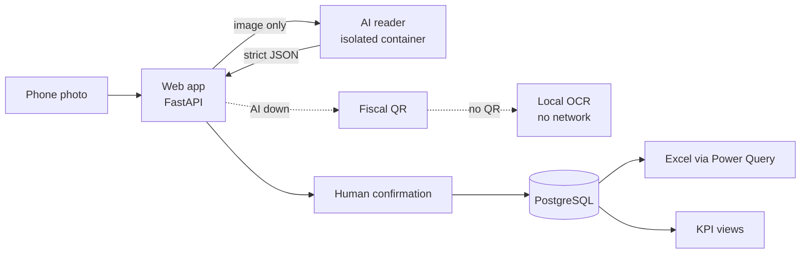

# Fleet Repair Receipts: from a Phone Photo to Clean Data

**Case study** of a production web app I designed and built for an industrial client: field staff photograph a repair invoice with their phone, an isolated AI service reads it, a person confirms the result, and the data lands in a single Excel workbook and KPI views for analysis.

> **About this repo.** The source code belongs to the client and stays private. This repository documents the problem, architecture, decisions and system metrics. The client is not named and no business data appears here.

**Status:** in production since September 2026 · built with spec-driven development and Claude Code as the coding agent, under my design, review and approval.

---

## The problem

Fleet repair costs had been typed by hand into a spreadsheet for 17 years. It depended on one person, data entry was slow and error-prone, and **only the typed numbers remained: the invoice itself was never kept**, so no record could be checked against its source. Nobody could analyze the spend by supplier or category with confidence.

## What changed

- **Every record now has its evidence.** The invoice photo is stored with the record, and the fields the reader located are highlighted on the photo for review. Photos of confirmed records are never purged.
- **17 years of history became usable data.** The full repair history was migrated, reconciled with zero differences, and now feeds the same KPI views as new records.
- **Metrics that did not exist before.** KPI views built on top of the full history and the new captures, by supplier and category, plus a single Excel workbook that refreshes itself.

## The solution

A mobile-first web app (PWA) that turns each receipt into a validated record:

1. **Capture:** the user photographs the receipt with the phone, inside a work-order batch.
2. **Read:** an isolated AI service extracts supplier, tax ID, date and amount as strict JSON.
3. **Fallback:** if the AI does not answer, the app reads the fiscal QR code printed on Argentine invoices, and then falls back to local OCR.
4. **Validate:** the supplier's tax ID is checked against the official taxpayer registry.
5. **Confirm:** a person reviews and confirms every value read. Nothing is saved on the AI's word alone.
6. **Deliver:** one Excel workbook that refreshes itself through Power Query, plus KPI screens by supplier and category.

## Measured before choosing the reader

| Field | AI reader | Local OCR |
|---|---|---|
| Supplier | 97% | 27% |
| Amount | 90% | 3% |
| Date | 71% | 21% |

About 3 seconds per photo, at a cost in the order of USD 0.0003 per read. The AI became the main path only after this comparison; OCR stayed as an offline fallback.

---

## Architecture

- **9 containerized services** with Docker Compose: web app, AI reader, network-less OCR reader, purge job, backups, watchdog, status, migrations and PostgreSQL.
- **Backend:** Python, FastAPI, SQLAlchemy, PostgreSQL 16, 27 Alembic migrations.
- **Frontend:** server-rendered pages and plain JavaScript, installable as a PWA.
- **Deployment:** VPS with Coolify behind Cloudflare; daily backups with a tested restore.
- **Monitoring:** a watchdog with Telegram alerts.

## Security by design

- **Isolated AI service:** it receives only the image. No database access, no stored photos, no privileges (`cap_drop: ALL`).
- **Tight AI requests:** zero data retention, no fallback to other models, a maximum price per request, a strict JSON schema and a monthly spend cap on the key.
- **Human in the loop:** every value read by the AI is confirmed by a person.
- **Access control:** three role levels and two-factor authentication for administrators.
- **Supply chain:** CI runs the full test suite, Ruff and gitleaks, with GitHub Actions pinned by SHA.
- **Data rule for AI-assisted development:** cloud AI never touches real data. The coding agent works only with synthetic data generated from the spec, and production diagnosis uses read-only, aggregate queries.

## Quality

- **2,300+ automated test functions:** unit, integration, UI (Playwright), structural and slow tests.
- **Spec-driven development:** project constitution, a spec in EARS notation with acceptance criteria, ADRs, a plan, tasks and test-first implementation.
- **Lossless migration:** 17 years of repair history were imported and reconciled by unit and year with zero differences. Corrections are recorded as audited reversals, never silent edits.
- **User acceptance:** an on-site session with end users on real invoices; the findings shipped in the following releases.

## Results

- **From planning to production in 3 days**, then continuous improvement over the following weeks.
- **Excel deliverable optimized:** download size from 7.8 MB to 0.9 MB, and reopening time from 166.7 s to about 16 s.
- **One source of truth** for repair spend, backed by the invoice photo and no longer dependent on a single person.

## Lessons learned

- **Measure before choosing a model.** The AI-vs-OCR comparison decided the architecture, not assumptions.
- **AI reads, a person confirms.** High accuracy is not 100%; the confirmation step keeps the data defensible.
- **Green CI is checked by hand before deploying.** A batch once reached production with a red CI; since then deployment is manual and only on green.
- **Secrets need the same discipline as code.** Keys exposed during development were rotated and verified by fingerprint.

## Stack

Python · FastAPI · SQLAlchemy · Alembic · PostgreSQL · Docker Compose · Coolify · Cloudflare · Gemini 2.5 Flash-Lite via OpenRouter · PaddleOCR (local) · Power Query · Playwright · pytest · GitHub Actions · gitleaks · Claude Code

---

*Félix Lezama · [Online CV](https://micv.techcam.com.ar) · [LinkedIn](https://linkedin.com/in/felix-lezama/)*
